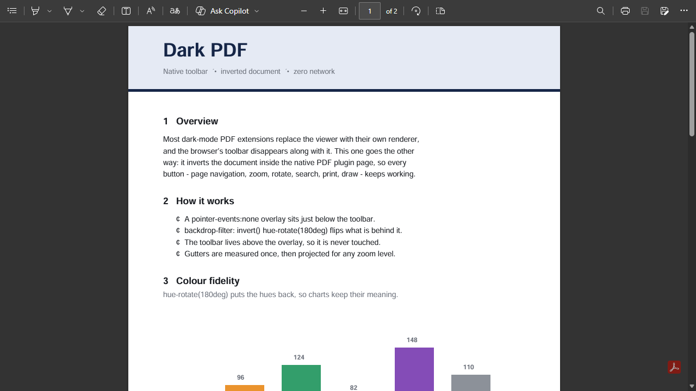
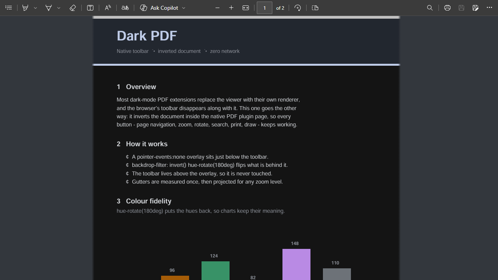
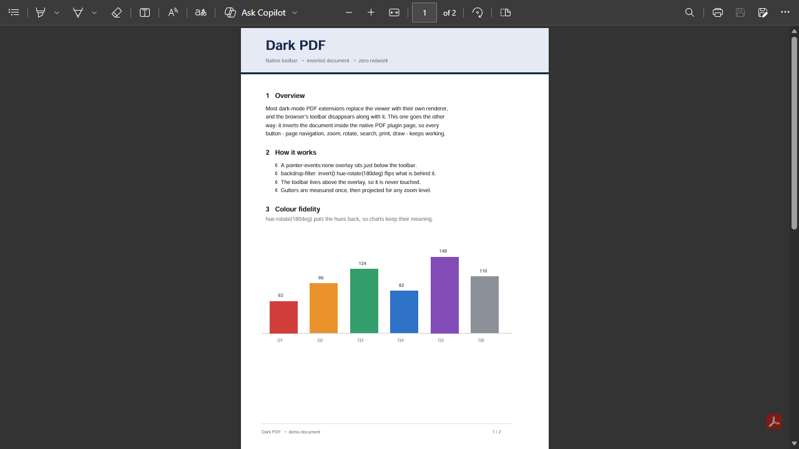
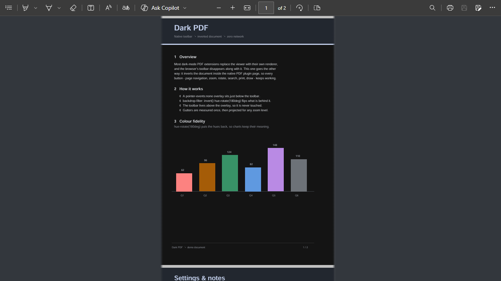
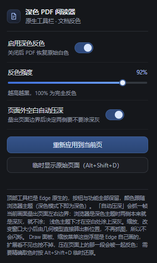

# 深色 PDF 阅读器 · Dark PDF

一个只有 **40 KB** 的 Edge / Chrome 扩展：打开 PDF 时把文档反色成深色，**完整保留浏览器原生的 PDF 工具栏**——页码、缩放、旋转、搜索、打印、绘图、Copilot 全都在。

不替换阅读器，不打包 pdf.js，不联网。

---

## 效果对比

同一份文档（[`docs/demo.pdf`](docs/demo.pdf)）、同一个窗口，只差扩展开关。

**100% 缩放**

| 关闭扩展 | 开启扩展 |
|:---:|:---:|
|  |  |
| 白纸 + 原生工具栏，长时间阅读刺眼 | 纸面反色成 `#141414`，工具栏原样保留 |

**缩小到 62%——页面外空白露出来的时候**

| 关闭扩展 | 开启扩展 |
|:---:|:---:|
|  |  |
| 浏览器自带的深灰桌面 + 白纸 | 纸面变深，桌面仍保持深灰 `#33373d`，没有变成浅灰 |

反色会把浏览器自带的深灰桌面一起翻成浅灰，所以「涂桌面」是单独做的一步：先量出页面矩形，只给矩形外面涂色，正文一个像素都不动。

---

## 它和别的深色 PDF 扩展有什么不同

大多数方案会把 PDF 交给自己的阅读器渲染，于是原生工具栏就没了。这个扩展反过来：**直接在浏览器原生的 PDF 插件页里做反色**，工具栏一个像素都不碰。

难点在于工具栏和文档画面在**同一层**（同一个 `<embed>`），所以不能简单地给 `embed` 加 `filter`——那样工具栏会一起被反色成浅色。最终方案是在工具栏下方盖一层 `pointer-events: none` 的遮罩，用 `backdrop-filter` 只反色它背后的画面。

---

## 特性

- **原生工具栏原封不动**：颜色跟随浏览器主题，深色主题下即深色
- **正文对比度零损失**：只做 `invert + hue-rotate`，不压曲线，公式、脚注、细笔画都清楚
- **页面外空白涂成深灰**（`#33373d`）：页面像浮在深灰桌面上，边界一眼可见
- **缩放 / 拖窗口不闪**：靠几何模型直接算出新边界，不再重新截图
- **彩色不跑偏**：`hue-rotate(180deg)` 把反色后的色相转回来，插图不会变负片
- **零网络**：不加载任何远程资源，截图只在扩展进程内解码，用完即弃，不落盘、不外传

| 缩小到 62% | 设置面板 |
| --- | --- |
|  |  |

---

## 安装

### Edge

1. 地址栏输入 `edge://extensions/`
2. 打开左下角 **开发人员模式**
3. 点 **加载解压缩的扩展**，选择本仓库根目录
4. 想读本机磁盘上的 PDF（双击打开），要在这个扩展的 **详细信息 → 允许访问文件 URL** 打开

### Chrome

1. 地址栏输入 `chrome://extensions/`
2. 打开右上角 **开发者模式**
3. 点 **加载已解压的扩展程序**，选择本仓库根目录
4. 同样需要在详情里打开 **允许访问文件网址**

> `manifest_version: 3`，最低 Chromium 102。

---

## 设置

点扩展图标：

| 项目 | 说明 |
| --- | --- |
| 启用深色反色 | 总开关，关掉立刻恢复原始白色 |
| 反色强度 | 50%–100%，100% 为完全反色；调低图片不会那么"负片" |
| 页面外空白自动压深 | 默认开。量出页面边界后把两侧空白涂成深灰 |
| 重新应用到当前页 | 手动刷新并重新标定（一般用不到） |

---

## 工作原理

### 1. 为什么能改原生 PDF 页

PDF 在浏览器里是一个**插件文档**（`document.contentType === 'application/pdf'`，DOM 只有 `<html><body><embed type="application/pdf">`）。manifest 里声明的内容脚本**进不去**，但 `chrome.scripting.executeScript` 可以程序化注入。

### 2. 为什么工具栏还在

工具栏和文档画面在同一个 `<embed>` 里。直接给 `embed` 加 `filter` 会把工具栏一起反色成浅色（实测工具栏从 `#3b3b3b` 变 `#b9b9b9`）。所以改成在**工具栏下方**（实测高 41px）盖一层 `pointer-events: none` 的遮罩，用 `backdrop-filter` 反色它背后的画面——工具栏在遮罩之上，完全不受影响。

### 3. 为什么空白要单独涂

页面外的空白是阅读器自己画的底色（深色主题下 `#333`），和文档同层。反色是单调映射：白纸 `#fff` 和这个底色 `#333` 反色后都会变成浅色（`#141414` 和 `#c0c0c0`）。

试过用 `brightness/contrast` 硬压、试过 `mix-blend-mode: color-burn`——都能把空白压黑，但**文字细笔画会一起被吃掉**（"MATHEMATICS" 断笔）。数学上这是无解的：反色后文字是 232、空白是 192，只差 40，任何单调映射要分开这两个值都会把中间调压死，而 CSS 滤镜和混合模式全是单调的。

所以改成**先量后涂**：`chrome.tabs.captureVisibleTab` 抓一帧 → 扫中间那一行 → 找出与左右空白色差最大的连续段（= 页面）→ 换算成视口百分比 → 在反色遮罩**之上**再盖一层只在两侧的深灰渐变。

### 4. 为什么缩放不闪

早期版本每次缩放都要重新抓图，而抓图前必须先把旧遮罩摘掉（否则画面最左边取到的是遮罩自己的颜色，基准色就错了），于是会露出约 200ms 的浅灰。

现在改成几何模型，**完全不用抓图**。实测 Edge 的 PDF 缩放就是 tab zoom，且页面宽度与 zoom 严格线性、与窗口宽度无关：

```
pageW = k × zoom
left   = (W - 滚动条 - pageW) / 2
```

`k` 是该文档在 100% 时的页面宽度（A4 正好 793.98 = 210mm × 96dpi），只在加载时标定一次。实测四个点全部吻合，误差 < 0.1%：

| zoom | 窗口宽 | 算出 | 实测 |
| --- | --- | --- | --- |
| 1 | 1280 | 18.36% | 18.36% |
| 0.422 | 1280 | 36.29% | 36.25% |
| 1.030 | 1280 | 17.43% | 17.42% |
| 1.030 | 1000 | 8.30% | 8.30% |

缩放走快路径：直接用 `onZoomChange` 事件自带的 `newZoomFactor` 算，一次注入就完事。连拍 16 帧验证，**没有一帧露出浅灰**。

### 5. 其他实现细节

- 在 `tabs.onUpdated` 的 `loading` 阶段就注入，早于 PDF 渲染，所以不会白屏闪一下
- 用固定 id 的 `<style>` + `<div>`，关闭时能干净移除，不受 Service Worker 被回收、内存状态丢失的影响
- 后台标签页抓不到画面，切到前台时补标定；标定过的标签页之后不再需要截图

---

## 已知限制

- 工具栏高度按 41px 计算。某个版本变高的话，遮罩上沿可能露出一条细浅边
- 多页滚动时，**两页之间那条横向缝隙**仍是被反色的浅灰（约 10px）。它随滚动移动，静态遮罩无法跟随，看起来像页与页之间的分隔线
- 几何模型假设同一文档各页等宽；混排页面尺寸的 PDF 翻页时边界会略有偏差
- 加密（需要密码）的 PDF 仍会正常提示输密码，反色照常生效

---

## 目录结构

```
.
├─ manifest.json     扩展清单（MV3）
├─ background.js     注入逻辑：探测 PDF 页 → 反色遮罩 → 标定边界 → 涂深灰
├─ popup.html/css/js 设置面板
├─ icons/            16 / 32 / 48 / 128 图标
└─ docs/             截图，以及截图用的演示文档 demo.pdf
```

---

## 版本历史

完整说明见 [Releases](https://github.com/hibit-SAA/dark-pdf/releases) 与 [CHANGELOG](CHANGELOG.md)。

| 版本 | 主要变化 | 安装包 |
| --- | --- | --- |
| **v2.3.1** | 修：先关掉扩展、缩小、再打开时，页面外空白停在反色后的浅灰 | [下载](https://github.com/hibit-SAA/dark-pdf/releases/tag/v2.3.1) |
| **v2.3** | 桌面改深灰 `#33373d`；缩放改用几何模型，不再闪烁 | [下载](https://github.com/hibit-SAA/dark-pdf/releases/tag/v2.3) |
| **v2.2** | 缩放 / 改窗口后重新量边界；页面铺满时自动撤掉遮罩 | 未留档 |
| **v2.1** | 页面外空白改为「先量后涂」，取代压曲线方案 | 未留档 |
| **v2.0** | 重写：保留原生工具栏，用 `backdrop-filter` 遮罩反色 | [下载](https://github.com/hibit-SAA/dark-pdf/releases/tag/v2.0) |
| **v1.0** | 初版：自带 pdf.js 阅读器，整页深色，但没有原生工具栏 | [下载](https://github.com/hibit-SAA/dark-pdf/releases/tag/v1.0) |

> v2.1 / v2.2 是同一晚的两个中间迭代，代码被就地覆盖、没有留档，只有变更说明。

---

## 声明

本项目在 **DeepSeek-V4.1-Flash** 的协助下完成：从「为什么 CSS 滤镜压不暗页面外空白」的推导，到几何投影模型 `pageW = k × zoom` 的标定，再到注入逻辑、设置面板和这份文档，均由人与模型协作产出。代码、截图与演示文档都是本项目自有的，不含任何第三方文档内容——截图用的就是 [`docs/demo.pdf`](docs/demo.pdf)，可以自己打开对照。

---

## 许可

[MIT](LICENSE)

---

## English

A 40 KB Chrome/Edge extension (Manifest V3) that inverts PDF pages into dark mode **while keeping the browser's native PDF toolbar fully intact** — page navigation, zoom, rotate, search, print, draw, Copilot, all of it.

Instead of replacing the viewer, it injects a `pointer-events: none` overlay just below the toolbar and uses `backdrop-filter: invert() hue-rotate(180deg)` on whatever sits behind it. The toolbar lives above the overlay, so it is never touched.

The light-grey gutters around the page are handled by measuring the page rect once (`captureVisibleTab` + a row scan), then **projecting** it for any zoom level via `pageW = k × zoom` — so zooming and window resizing never re-capture, and therefore never flicker.

**Install:** `edge://extensions/` → enable Developer mode → Load unpacked → pick this folder. Enable "Allow access to file URLs" to read local PDFs.

**Credit:** built with the assistance of **DeepSeek-V4.1-Flash** — the analysis of why CSS filters alone cannot darken the page gutters, the `pageW = k × zoom` calibration, the injection logic and this document were produced collaboratively by a human and the model.
